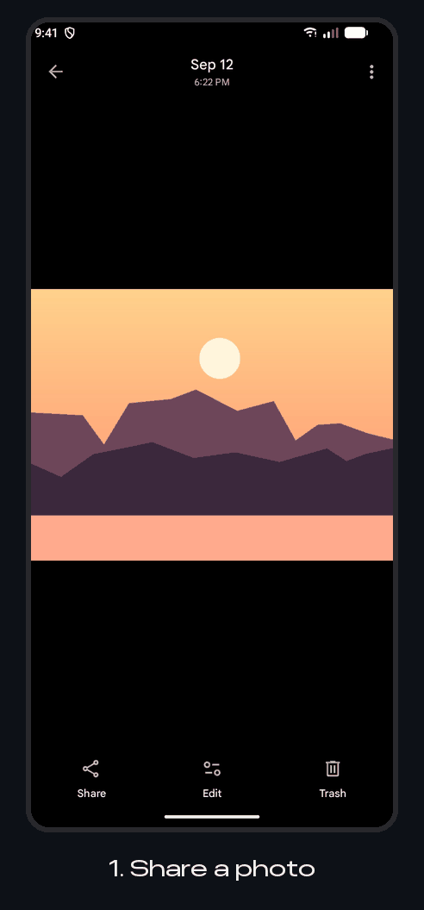
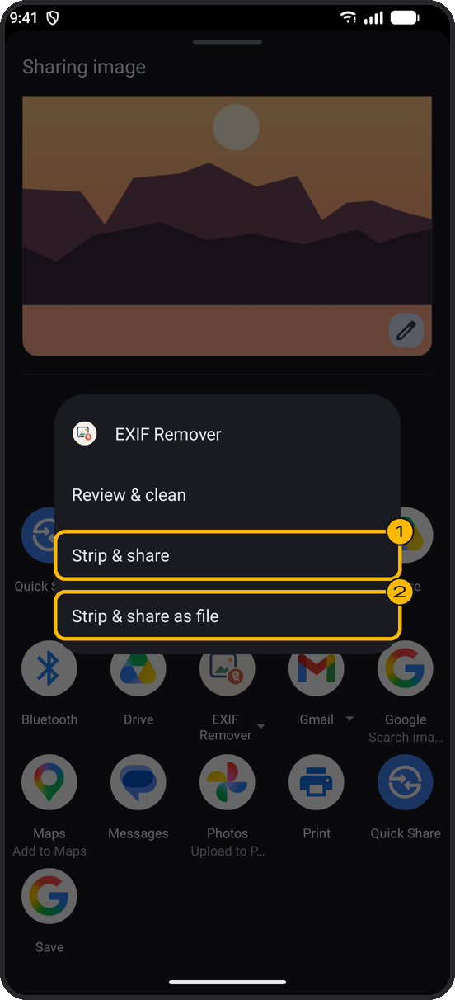
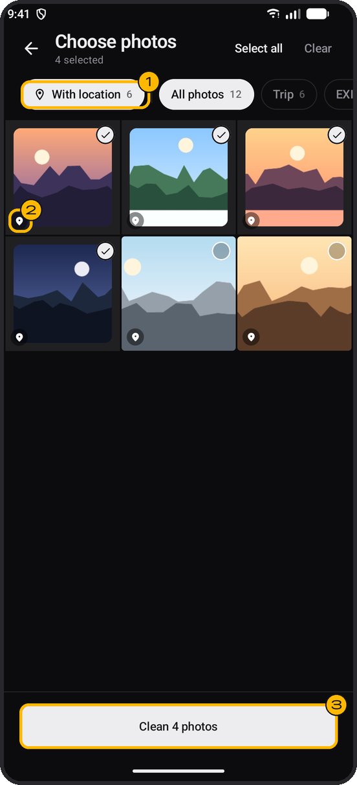
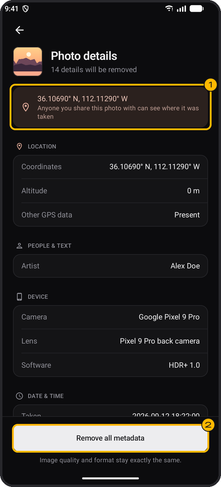
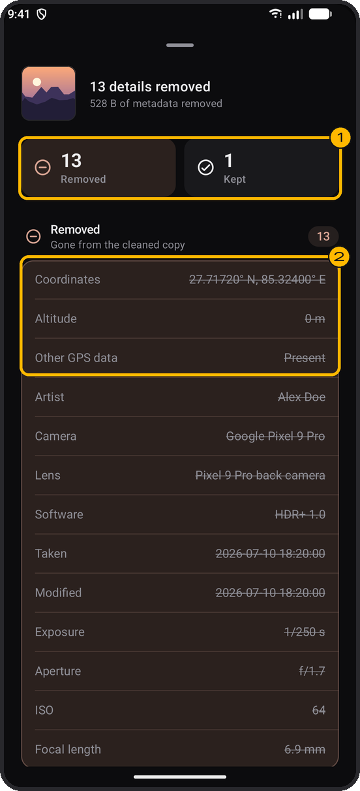
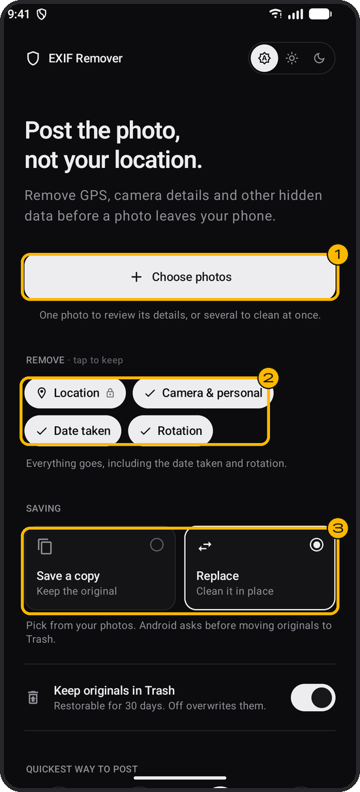

# EXIF Remover

**Post the photo, not your location.**

A small Android app that removes GPS coordinates, camera details and other hidden data from your photos before you share them. Everything happens on your phone. The app has no internet permission, so your photos never go anywhere.

<p align="center">
  
</p>

## Why you need it

Every photo your phone takes carries hidden information, called EXIF metadata, inside the file:

- **Where it was taken.** Exact GPS coordinates, often accurate to a few metres. A photo taken at home gives away your home address.
- **When it was taken**, down to the second.
- **What took it.** Phone make and model, lens, camera settings, and sometimes the owner's name or a serial number.

Some apps strip this when you post. Many don't, especially when a photo is sent as a file, by email, in cloud links or in some chat apps. Anyone who receives the original file can read all of it with free tools.

EXIF Remover takes it out before the photo leaves your phone.

## Download

Get the latest APK from the [Releases](../../releases) page and open it on your phone. Requires Android 11 or newer.

Because the app doesn't come from the Play Store, Android may offer to scan it before installing. Tap **Scan app** and it will install normally.

## How to use it

### The quickest way: share through it



1. In your gallery, pick a photo and tap **Share**.
2. Tap **EXIF Remover**. Some phones show its options straight away.
3. Choose one:
   - **① Strip & share.** The share sheet opens again with a clean copy. Pick the app you were going to send it to.
   - **② Strip & share as file.** Sends the clean copy as a document, so WhatsApp and other chat apps don't compress it. Use this to send a photo at full quality.

Your original photo is not changed.

<br clear="right">

### Clean photos in the app

1. Open EXIF Remover and tap **Choose photos**.
2. Select the photos you want to clean, then tap **Clean**.
3. Check the results, then tap **Share**, or save the clean photos.

<table>
  <tr>
    <td align="center" width="33%"></td>
    <td align="center" width="33%"></td>
    <td align="center" width="33%"></td>
  </tr>
  <tr>
    <td valign="top"><b>Choose photos</b><br>① <b>With location</b> shows only photos that reveal where they were taken.<br>② The pin marks a photo that has a location.<br>③ Clean them all at once.</td>
    <td valign="top"><b>Look before you clean</b><br>Pick a single photo to see everything hidden in it.<br>① Where the photo was taken.<br>② Remove it all in one tap.</td>
    <td valign="top"><b>See what was removed</b><br>Tap any photo in the results.<br>① How many details were removed and kept.<br>② Removed values are struck through.</td>
  </tr>
</table>

### Choose what to remove



The home screen has everything in one place: ① **Choose photos**, ② what to remove, and ③ how to save.

Tap the chips under **Remove**:

| Option | What it does |
| --- | --- |
| **Location** | Always removed. |
| **Camera & personal** | Phone model, camera settings, owner name and other details. Turn it off to remove only the location. |
| **Date taken** | Keep it so the photo stays in the right place in your gallery's timeline. |
| **Rotation** | Keep it so photos stay the right way up. |

### Choose how to save

- **Save a copy.** Clean copies go to `Pictures/EXIF Remover`. Your originals stay as they are.
- **Replace.** The original is cleaned in place. With **Keep originals in Trash** on, the original goes to the system Trash, where you can restore it for 30 days.

<br clear="right">

### Shortcuts

- **Long-press the app icon** to clean your latest photo or latest screenshot in one tap.
- Add the **Clean photos** tile to Quick Settings to open the photo picker from anywhere.

## What it handles

- JPEG, PNG, WebP, HEIC, HEIF and AVIF photos are cleaned without re-compressing the image, so quality is unchanged.
- Other formats, such as GIF and BMP, are converted to JPEG.
- Besides EXIF, it also clears XMP data and manufacturer-specific blocks that can hold the same information.

## Privacy

- No internet permission. Nothing is uploaded, tracked or logged.
- Clean copies made for sharing are deleted automatically.
- Photo access is only used to show your gallery and to read and clean the photos you choose.

## Building from source

Open the project in Android Studio, or run:

```sh
./gradlew assembleDebug
```

Pushing a version tag such as `v1.2.1` makes GitHub Actions build a signed APK and publish it as a release. See [`.github/workflows/release.yml`](.github/workflows/release.yml) for the secrets it needs.
